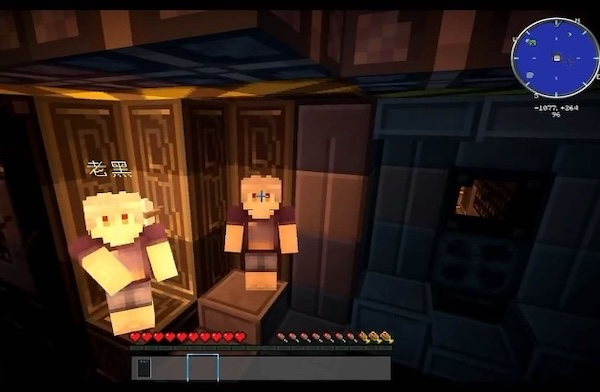
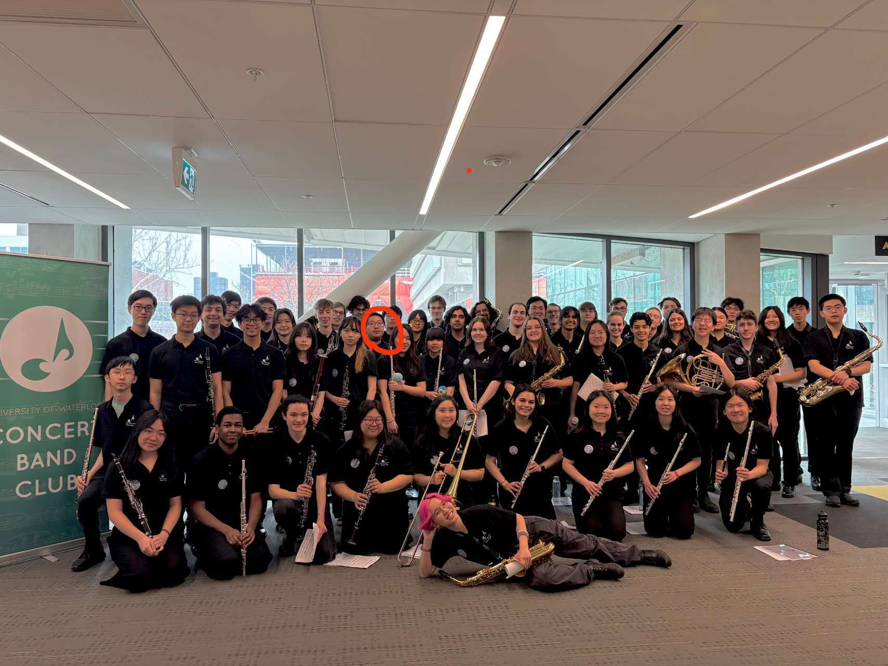
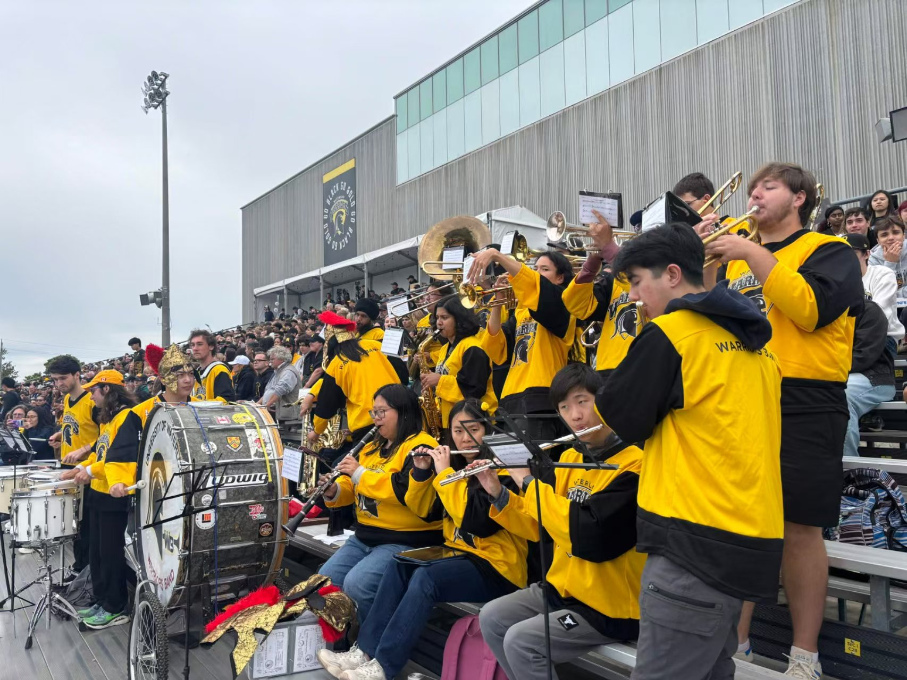

# What is this?

Here are a few of my personal stories, if you are interested. If you are a recruiter looking for my projects and experience, you may want to start with the other pages.

This page is less technical and more personal. It is a place to share my thoughts, and I hope some of them resonate with you.

This page is long: it covers my past, my stories, and my thoughts. It is more like a blog than a simple "More About Me" page. If you want to learn why I chose coding and why I call myself "OFTS," you are welcome to stay!

# So, Why Software Engineering?

I’ve seen people choose software engineering for a high salary, parental pressure, or peer pressure. My path into coding was different.

:::: columns flex="1 1"
::: column
You have probably heard of Minecraft. That's where my story began. Minecraft is famous for its modding community. When I wrote this page, there were approximately 200,000 Minecraft mods on CurseForge, without counting those hosted elsewhere. When I first discovered mods in elementary school, I was amazed by the possibilities they offered. Gradually, a thought popped into my head: "Can I make my own mod?"

This is a screenshot of the modpack (made around 2016) that inspired me to make my own mod.

Note that the original video was lost; this is an archive.
:::

::: column

:::
::::

A childhood dream can be powerful. That ambition encouraged me to learn coding and modding, along with the tools needed to make mods. Now, I can confidently say that I am a modder, with more than 10,000 cumulative downloads. Having achieved the goal I set in elementary school and seen what coding makes possible, I knew I wanted to pursue it as a career. Without hesitation, I wrote "Software Engineering" on my university application. That's the story behind my choice.

# What does 'OFTS-CQM' stand for?

I have used that name as my Minecraft ID for several years. CQM is the initials of my Chinese name, Chen Qianmu, and OFTS has a more complicated origin.

Back then, I played Minecraft: Story Mode, a game about the adventures of a team called the Order of the Stone. That's where OFTS comes from: Order oF The Stone. I picked the name almost 10 years ago. I remember its origin, but I have forgotten why I chose OFTS instead of OOTS.

I really liked the Order of the Stone and imagined joining them to explore the world and defeat villains. Come on, everyone has a heroic childhood dream, right? I added my initials to OFTS, and it became OFTS-CQM.

I use OFTS-CQM for most of my game accounts and for GitHub, which I originally used to store my mods' code.

# Any interesting stories about Minecraft and coding?

Minecraft: Java Edition uses Java! So if I wanted to make Minecraft mods, I needed to learn Java. That was what I thought when I started learning. My first programming language was Java...Script!

Yes, that's the real story. I searched for Java, and the first result was JavaScript.

I thought JavaScript was some kind of formal name for Java because, you know, programmers like abbreviations.

I spent four months learning JavaScript and still couldn't read Minecraft's source code. I told myself it was going to be hard and that it might take a year or two to become proficient enough to read the code... until I realized I had been learning the wrong language...

# Why "Macrohard Virtual Studio"?

I wanted my website to stand out and look like a programmer's website. It should feel personal and thoughtfully made.

I wanted something technical and related to coding. I couldn't imagine what design to choose, but I had a basic outline of the content. I opened VS Code and started writing. Then I realized that was exactly the design I was looking for.

So I created Macrohard Virtual Studio v6.7.0. I gave it a playful name inspired by a familiar code editor.

# I heard you're in a band?

:::: columns flex="1 1"
::: column
Yes! Studying can get a bit repetitive, so I joined a band. Eventually, I joined a second one too.

The band is called UWCBC (University of Waterloo Concert Band Club), and I play euphonium in it. If you don't know what a euphonium is, it is similar to a tuba but much smaller, roughly the size of a French horn.

It is a lot of fun, and I recommend joining a band. I've been playing music since elementary school, and it has become an indispensable part of my life.
:::

::: column

:::
::::

:::: columns flex="1 1"
::: column

:::
::: column
Update: It's two bands now!

I also joined the UW Warriors Band, playing sousaphone.
:::
::::
