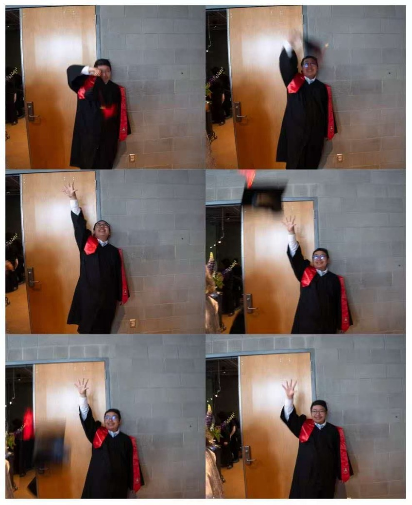
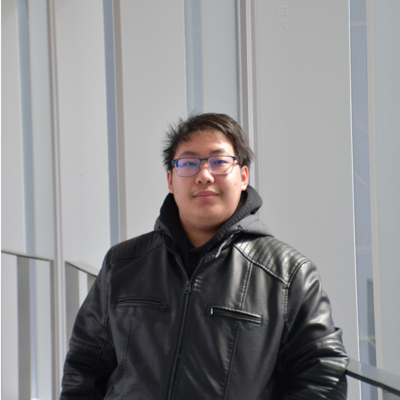

# Welcome to OFTS_CQM (Sam Chen)'s Codespace!

:::: columns flex="4 6"
::: column

*Picture by my high school friend Wilton*
:::

::: column
Congratulations! You found OFTS_CQM (Sam Chen)'s codespace! You can learn more about me here.

I am a software engineering student at the University of Waterloo, excited to explore computing, web and app development, video game design... and a lot more!

I'm working on more projects, and I'll share them here (or on LinkedIn) when they're ready.

I don’t know everything, but I am always learning more about software engineering, programming languages, and frameworks.

## ---- By OFTS_CQM
:::
::::

*Hint: you can click the "Terminal" tab above and explore my codespace in a terminal!*

## What’s Your Tech Stack?

I am proficient in object-oriented languages such as C# and Java, as well as game engines such as Unity. I also build websites using frontend frameworks such as React and Vue, along with CSS, Tailwind CSS, and HTML. For backend development, I use Java and Kotlin frameworks such as Spring, Javalin, and Ktor; Python frameworks such as Flask; and C# with .NET Core. I have built Android apps with Android Studio and Java/Kotlin, and desktop apps with JavaFX, Swing, and Qt/QML.

## Where do you study?

:::: columns flex="10 4"
::: column
I study software engineering at the University of Waterloo. It is a demanding program, but I have learned a lot, made many friends, and even joined a band. Despite the workload, I enjoy university life.
:::

::: column

*Picture by University of Waterloo*
:::
::::

## Want to learn more? Explore the files on the left (or below on mobile)!
